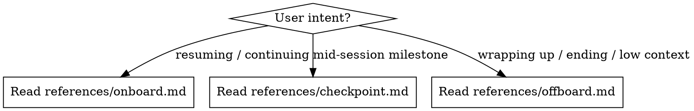

# Journaling Session Memory

Transfer working context between Claude sessions so the next session resumes without re-discovering what was done, what failed, and what's next.

Design: an append-only journal (one file per session) plus a small curated COMMON.md read at every onboard. Past sessions are immutable evidence; COMMON.md is promoted, project-scoped knowledge with links back to the evidence. Nothing is ever lost, and onboard cost stays roughly constant regardless of project age.

## Which Mode?



After determining the mode, read the corresponding reference file and follow it.

## Project Layout

By default, session memory lives in `context/session_states/`:

```
context/session_states/
├── COMMON.md          - durable project knowledge + topic index (read every onboard)
├── 0000-legacy.md     - pre-migration SESSION_STATE.md verbatim (only if migrated)
├── 0001-<slug>.md     - one file per session, immutable once finalized
└── NNNN-<slug>.md     - highest id = latest session (live until finalized)
```

Projects can override the folder in their CLAUDE.md with a line like:

```
session states: path/to/folder
```

Session ids are zero-padded sequence numbers; the next session takes highest id + 1. Slug is 2-4 words describing the session's main work.

## Git State

Both onboard and offboard run:

```bash
bash ~/.claude/skills/journaling-session-memory/scripts/git-state.sh
```

## Session File Template

```markdown
---
id: 0004
slug: auth-refresh
started: 2026-07-21
finalized: false
branch: feat/auth-refresh
head: <git short hash at finalization>
tasks: [T-12]
topics: [auth]
---

# Session 0004 - auth-refresh

## Milestones

Appended during the session at checkpoint triggers (see references/checkpoint.md).
Never rewritten, never reordered.

- decision: rotate refresh tokens, access tokens stay short-lived (user call)
- abandoned: middleware-level CSRF check - fails on websocket upgrade paths (root cause: middleware runs before protocol switch)
- done: `backend/routers/auth.py` - rate limiting endpoint

## Corrections

Append-only. Corrects an earlier entry in this or any past session file.
Never edit history in place, even in this file's own Milestones.

- correction: the 0003 decision on cookie domains was based on a wrong assumption about subdomain handling; superseded, see COMMON.md D-05

## Handoff Capsule

Written at offboard. The ONLY part of this file the next session must read.
Everything above is evidence; this is the handoff. Keep it compact.

### Status

one line: planning / implementing / testing / debugging / blocked

### What's Done

- `path/to/file`: what was done (one line per file, this session only)

### Work Checklist

- [-] `path/to/file`: in progress - what's done vs remaining
- [ ] `path/to/file`: not started - what to do

### What's Next

- immediate next steps, in order, specific enough to start cold

### Failed Approaches

Only when the project has no task tracker (tracker projects: these live in task
notes, written at the moment of abandonment). What was tried, what broke, WHY.

### Open Questions (session-scoped)

- questions needing user input that belong to this work, not the project at large

### Uncommitted Changes

"All committed" / "Stashed as: session: <desc>" / description of dirty state

### Docs That Will Need Reading

- `path/to/doc.md` - why the next agent needs it before touching code
- `/skill-name` - why this task needs it invoked

### Docs That May Need Updating

- DOC.md: what changed that made it stale (omit section if nothing)

### Retrieval Hints

- terms, paths, or task ids a future session could grep the archive for when
  work circles back to this area (omit if nothing non-obvious)
```

## COMMON.md Template

```markdown
# Common Knowledge

Budget: target 120 nonblank lines, hard ceiling 150. Check with:
`grep -cv '^\s*$' COMMON.md`. Over 120 at onboard: compact (see Section Rules)
or record here in one line why compaction isn't possible.

## Constraints & Conventions

Rules that repeatedly affect work. Cap ~15 lines.

- C-01: all timestamps stored UTC, rendered local (user decision, 0001)

## Active Decisions

Still-governing, project-scoped decisions only. Cap ~30 lines.
Format: anchor [status]: decision - why. Evidence: session id(s).

- D-03 [active]: rotate refresh tokens, access tokens short-lived - limits blast radius of token theft. Evidence: 0004

## Open Questions

Blocking or likely to recur. Cap ~15 lines.

- Q-02 [open]: refresh-token revocation strategy undecided (blocks T-14). Raised: 0004

## Tombstones

One-line redirects only. Cap ~15 lines.

- D-01 [superseded by D-03]: per-request tokens - too chatty. See 0002

## Topic Index

Inverted index: topic -> sessions that touched it. Coarse, subsystem-level
topics (aim for 5-15 per project). Cap ~30 lines.
Format: topic [status] (task ids): session ids - one-phrase state.

- auth [open] (T-12): 0000, 0001, 0004 - JWT done, refresh questions pending
- data-import [done]: 0000, 0002
```

## Rules

### Authority

- Task tracker (`.tasks/`, see /managing-tasks) owns task state. Never restate tracker status in COMMON.md beyond a task id reference.
- Journal files own narrative evidence. Finalized files are never edited; fixes go in the current session's Corrections.
- COMMON.md owns promoted project-scoped knowledge, always with an evidence link (session id) pointing back into the journal.
- On conflict: tracker beats journal on task state; the newest journal entry beats COMMON.md on facts (and COMMON.md should then be updated).

### What Goes Where

- Task-scoped fact (failed approach, constraint discovered while doing task X): `task add-note <id>` at the moment it's learned, plus a one-line milestone. It expires with the task, which is the point. No tracker: milestone line now, promote to COMMON.md at offboard only if it matters beyond the task.
- Project-scoped fact (architecture decision, convention, cross-cutting constraint): milestone line now, promote to COMMON.md at offboard.
- Session-scoped narrative (what happened, what's next): the session file only.

### Topic Index

- Match-first rule: before creating a topic, read the existing list and reuse. Topics are subsystems, not features.
- Status is a per-line tag, not a section - a topic can be part done, part open.
- The index is advisory, never a gate: if a grep points strongly at an unindexed session, read it anyway. But if current work touches an indexed topic, reading those sessions' capsules is expected, not optional.

### COMMON.md Budget

Eviction order when over 120 nonblank lines:

1. Superseded entries: reduce to one-line tombstone with replacement anchor + evidence link
2. Shelved items untouched for ~5-10 sessions
3. Resolved open questions (promote the answer to a decision only if still project-scoped)
4. Decisions now fully represented in code, tests, or project docs
5. Index detail: collapse long session-id lists to the most relevant few

Never evict: active user decisions, unresolved questions blocking active work, security / data-loss / compatibility constraints, do-not-retry failures with a reusable root cause.

### Redaction

Never write secrets, tokens, keys, credentials, or private user data into journal files or COMMON.md - these files are permanent. Reference the location instead ("credentials in .env, see README").

### Immutability

A session file with `finalized: true` is never edited again, by anyone, for any reason. Wrong content in a finalized file is fixed by a Corrections entry in the current session file plus a COMMON.md update if the wrong fact was promoted.

## Migration from preserving-session-memory

Handled at onboard, purely mechanical, no classification. See references/onboard.md Step 1.
