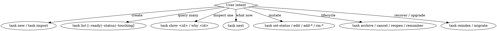

# Managing Tasks

Self-owned replacement for Task Master. Tasks live as YAML files under `.tasks/<prefix>-<slug>.yaml`; mutations serialized via a project-wide file lock; ULID identity survives renumber and branch merges. Primary consumer is Claude.

## When to use

- User invokes `task ...` or asks about task state
- `/planning-tasks` Step 6 emits a batch → `task import`
- `/reviewing-code` Pass 6 emits follow-up findings → `task new`
- `/preserving-session-memory` derives done/pending sections from `task list`

## Decision graph

## CLI entrypoint

Binary: `~/.claude/skills/managing-tasks/bin/task` (Node shim). Projects alias to `task` in shells.

Every command prints YAML on stdout (starts with `contract_version: 1`) or a formatted multi-line block for human-oriented commands (`list`, `show`, `deps`, `grep`, `why`, `next`). Errors go to stderr; exit code classifies the failure (see `references/exit-codes.md`).

Quick reference: `init | new | import | list | show | next | deps | grep | why | set-status | edit | add-file | rm-file | add-change | add-dep | rm-dep | add-subtask | edit-subtask | add-note | add-test | add-source | rm-source | move | rm | cancel | reopen | archive | reindex | renumber | migrate`.

Full flag and example spec: `references/cli-reference.md`.

## Project configuration

Read from project `CLAUDE.md` under a `/managing-tasks` block:

- Tasks directory — default `.tasks/`. Override rare; not currently wired.
- Archive policy — manual only (no auto-archive). Users run `task archive --older-than <days>` or `task archive --id <id>` explicitly.
- TDD subtask kinds — freeform `kind:` label on subtasks (e.g., `RED`, `GREEN`). Tracker does not enforce.

No config file is required; the CLI works with defaults.

## Integration contract

Producer skills invoke the CLI and branch on `contract_version`. If the CLI returns a mismatched version, the producer must surface an actionable error, not silently continue.

Integration shapes (per command):

- `task new` → `{contract_version, id, uid, file}`
- `task import` → `{contract_version, label_map: {<label>: <id>}, created: <n>}`
- `task list [--compact]` → multi-line text (not YAML). Parse line-by-line if needed.
- `task show <id>` → YAML detail (all fields + `archived: bool`).
- `task why <id>` → multi-line text: title, goal, source list. Not YAML.
- Mutation commands → `{contract_version, id, ...delta}`.

Full per-command schemas: `references/integration-contract.md`.

## File format

Every task file: `schema: 1` at top; `uid` (ULID, immutable), `id` (human-readable string), `title`, `status` required. Optional: `depends_on`, `depends_on_uids`, `goal`, `files[]`, `tests[]`, `notes[]`, `subtasks[]`, `sources[]`. Filename prefix sets display order; ULID is identity. Full shape and rules: `references/file-format.md`.

## Invariants

- All writes are atomic (tempfile + fsync + rename + dir fsync).
- All mutations acquire a project-wide exclusive lock at `.tasks/.cache/lock` (proper-lockfile). Queries share the same lock — option A collapse, serialized; cost trivial for solo workflow.
- `done` requires all subtasks terminal (done|cancelled) and all deps terminal — unless `--force`.
- `add-dep` to a cancelled or archived task is rejected.
- `add-dep` that retroactively invalidates a `done` task is rejected — reopen first.
- `cancel` with active dependents is rejected without `--force`.
- `archive` refuses tasks referenced by active deps.
- `list` tolerates malformed task files (one `[?] INVALID` row per file); every other command hitting a malformed file returns exit 2 (not found) or exit 1 (internal error) depending on whether the malformed file is the target.

## Schema migration

Every file has `schema: 1`. CLI supports v1 only — any file with `schema != 1` is rejected (older → exit 3, newer → exit 6). No prior-version support until v2 ships. `task migrate --dry-run` prints the plan; no silent rewrites on other commands.

## Bootstrap

`task init` is idempotent: creates `.tasks/.cache/`, appends `.tasks/.cache/` to `.gitignore` if missing, rebuilds cache. Every mutation auto-creates `.tasks/` if absent.

Node deps (`yaml`, `proper-lockfile`, `ulid`) are pinned in the skill's `package.json` and installed under `~/.claude/skills/managing-tasks/node_modules/`. The shim checks for `node_modules/`; missing → exit 1 with install instruction.

## Maintenance

See `MAINTENANCE.md` for where new knowledge lands.
