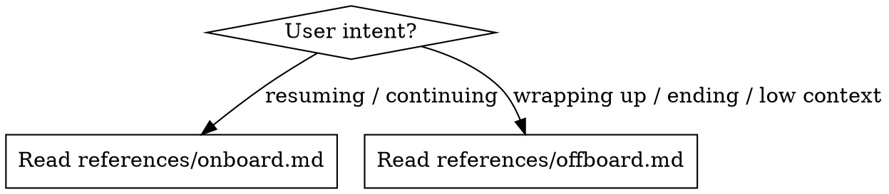

# Preserving Session Memory

Transfer working context between Claude conversations so the next session resumes without re-discovering what was done, what failed, and what's next.

## Which Mode?



After determining the mode, read the corresponding reference file and follow it. Both modes use the SESSION_STATE.md template and section rules below.

## Project Configuration

By default, SESSION_STATE.md lives at `context/SESSION_STATE.md`. Create the `context/` directory if it doesn't exist.

Projects can override this in their CLAUDE.md. Look for a line like:

```
session state: path/to/SESSION_STATE.md
```

If no override is found, use the default path.

## Git State

Both modes use the git state script. Run it as:

```bash
bash ~/.claude/skills/preserving-session-memory/scripts/git-state.sh
```

## SESSION_STATE.md Template

Both modes read and/or write this file. Use this exact structure:

```markdown
# Session State

## Task

<task tracker ID + title (from `task show <id>`), or free-text description if no tracker>

## Branch

<git branch name>

## Status

<one-line: planning / implementing / testing / debugging / blocked>

## Docs That Will Need Reading

Doc files (and skills to invoke) the next agent needs before touching code —
not what happened, but what to load first.

- `path/to/doc.md` — why it's relevant to the current/next task
- `/skill-name` — why this task needs it invoked

## What's Done

Completed files — one line each, filename + what was done. These are graduated
from the work checklist (were `[x]`, now archived here as compact references).

- `backend/routers/auth.py`: Added rate limiting endpoint
- `backend/services/auth_service.py`: JWT CSRF validation
- `frontend/src/components/loginPage.ts`: Login form with error handling
- `path/to/file`: what is done in this file

## Work Checklist

Remaining and in-progress files only. Checked items graduate to "What's Done"
above — do NOT keep `[x]` entries here.

- [-] `backend/routers/admin.py`: PATCH endpoint written, DELETE not started
- [ ] `backend/tests/api/test_admin.py`: Not started
- [ ] `frontend/src/components/adminPage.ts`: Not started
- [ ] `path/to/file`: what to do
```

Legend: [ ] not started, [-] in progress, [x] → move to "What's Done"

## What's Next

- <immediate next steps, in order>

## Failed Approaches

- <what was tried, what went wrong, WHY it failed>
- <THIS IS THE HIGHEST-VALUE SECTION — without this, next agent repeats the same mistakes>

## Uncommitted Changes

<"All committed" / "Stashed as: session: <desc>" / description of dirty state>

## Discussion Summary

Narrative of any decision-making, structuring, or long-term-planning discussion
with the user this session - the "why we talked it through" that isn't already
a discrete entry in Decisions & Open Questions. Omit if the session was purely
implementation/ops.

- <topic discussed, the shape of the back-and-forth, where it landed>

## Decisions & Open Questions

- <architectural/design decisions made + reasoning>
- <user's decisions and preferences affecting detailed implementation>
- <open questions needing user input>
- <THIS IS THE 2nd HIGHEST-VALUE SECTION — without this, next agent misses important context>

## Docs That May Need Updating

- FILE_STRUCTURE.md: added feature_a.ts, feature-a.spec.ts
- README.md: new env var FEATURE_A_KEY

```

## Section Rules

### Docs That Will Need Reading

- List doc files AND skills relevant to the current and immediate next task only — not everything the project has
- If a task tracker task has a `kind` (see `/managing-tasks`), derive this section from the project's CLAUDE.md task-kinds table rather than guessing from memory
- Distinct from "Docs That May Need Updating" below — this section is about what to load, that one is about what's gone stale

### What's Done

- One line per file: backtick-wrapped path + short phrase of what changed
- Graduated from checklist — these were `[x]` items
- Include task/issue ID if applicable
- New files: mark as "New file"
- This section only grows within a session; next session can trim old entries if task is fully complete

### Work Checklist

- Only `[ ]` (not started) and `[-]` (in progress) items remain here
- When marking a file `[x]`, immediately move it to "What's Done" as a one-liner — do NOT leave `[x]` in the checklist
- Per file: backtick-wrapped path + specific status (what's done vs remaining)
- Group by parent directory if 3+ files share one
- Mark incomplete files explicitly (e.g., "PATCH done, DELETE not started")

### Failed Approaches

This is the most valuable section for the next session. Without it, the next agent will waste time retrying things that already failed. Always include:

- What was attempted
- What went wrong
- **WHY** it failed (root cause, not just symptoms)

### Discussion Summary

- Optional - include only if the session had decision-making, structuring, or long-term planning discussion; skip for pure implementation/ops sessions
- Captures the narrative of *how* a conclusion was reached, not just the conclusion (which belongs in Decisions & Open Questions)
- Distinct from Failed Approaches: that's what was tried and abandoned in code; this is what was talked through with the user

### Decisions & Open Questions

Second most valuable. Without this, the next agent may diverge from the intended path. Include:

- Architectural choices and their reasoning
- User preferences that affect implementation
- Open questions that still need user input

### Docs That May Need Updating

- Optional — only include if code changes invalidated documentation
- Reference the doc name and what changed (e.g., "FILE_STRUCTURE.md: added feature_a.ts")
- The doc list comes from whatever the project's CLAUDE.md references — there is no hardcoded list

## Task Tracker Integration

The project may use `/managing-tasks` (YAML files under `.tasks/`). Tracker is authoritative on task state; SESSION_STATE is authoritative on narrative (Failed Approaches, Discussion Summary, Decisions & Open Questions).

Skip every tracker step if `.tasks/` doesn't exist — no tracker, no derivation.

- **Offboard** derives "What's Done" and "Work Checklist" from `task list` output; see `references/offboard.md` Priority 2.
- **Onboard** reads `task list --ready` to surface next actionable work; see `references/onboard.md` Step 3.
```
